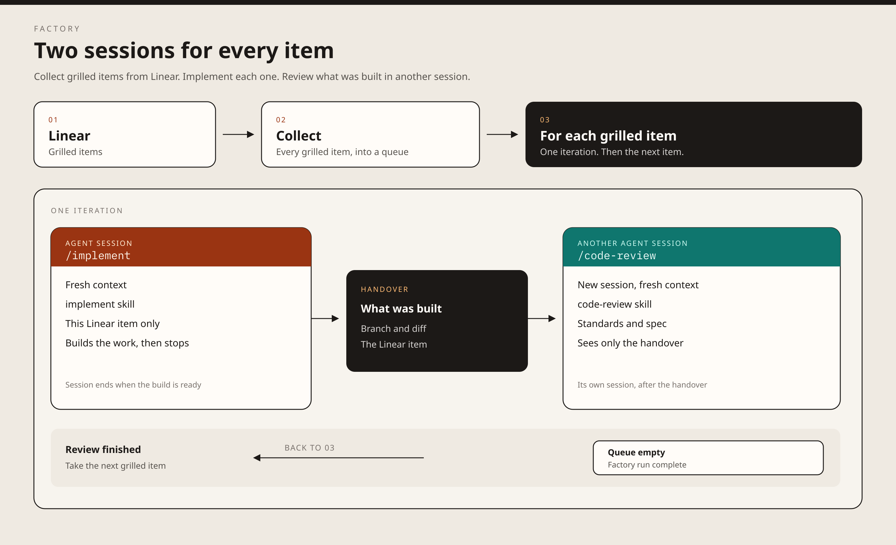

# Factory



Grilled Linear items are collected into a queue. Each item is built in one agent session with mattpocock's implement skill, then handed to a new session that runs `/code-review`.

## v0

```bash
LINEAR_API_KEY=lin_api_... ./v0/run.sh /path/to/repo
```

`LINEAR_LABEL` defaults to `grilled`. The script reads up to 50 open issues with that label, then runs two fresh `grok` sessions per issue. Tool use in those sessions is auto-approved.
